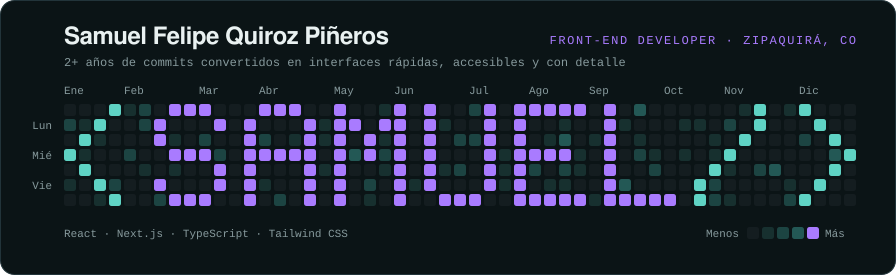

### ▶ Jugador

Hola 👋, soy **Samuel**, desarrollador Front-End con más de dos años creando interfaces rápidas y precisas, a la medida de cada desafío.
Trabajo con **React, Next.js, TypeScript y Tailwind CSS**, integro APIs y sistemas backend y cuido el SEO técnico, la accesibilidad y el rendimiento.

### 🎒 Inventario

### 🏆 Misiones completadas

| Misión | Qué es | Stack |
| --- | --- | --- |
| [**Portafolio**](https://github.com/Theace07/portafolio) | Mi portafolio: tema claro/oscuro, bilingüe, fondo interactivo y un sistema de animaciones propio | Next.js · TypeScript · Tailwind |
| [**Vino · BAKOS**](https://github.com/Theace07/Vino) · [demo](https://proyecto-coder-seven-virid.vercel.app) | Sitio multipágina sobre el mundo del vino | HTML5 · SCSS |

### 📈 Actividad

<picture>
  <source media="(prefers-color-scheme: dark)" srcset="https://raw.githubusercontent.com/Theace07/Theace07/output/snake-dark.svg"/>
  <source media="(prefers-color-scheme: light)" srcset="https://raw.githubusercontent.com/Theace07/Theace07/output/snake.svg"/>
  
</picture>

La pantalla de título, el inventario y la terminal se dibujan con código: <code>node scripts/build-svg.mjs</code>. La serpiente la genera una GitHub Action cada día.

🗂️ <b>Bocetos anteriores</b> · cómo llegué a la pantalla de título

 

**Boceto 1 · Banner editorial.** Nombre en serif con auras de color, en la línea visual del portafolio.

**Boceto 2 · Gráfico de contribuciones.** 53 semanas × 7 días, como el de GitHub, que dibujan `<SAMUEL/>`.

**Versión final · Pantalla de título pixel art**, la de arriba del todo.

