  

### § 01 · Perfil

Desarrollador Front-End con más de un año creando interfaces responsivas y rápidas para clientes de Argentina y Colombia.
Trabajo con **React, Next.js, TypeScript y Tailwind CSS**, integro APIs y sistemas backend y cuido el SEO técnico, la accesibilidad y el rendimiento.

- 🔭 Lo último: dashboards con Next.js y MongoDB para administrar datos de forma centralizada.
- 🧪 Trabajo con Scrum y Kanban, con code review y testing automatizado.
- 🌎 Español nativo · Inglés B2 · Remoto desde Zipaquirá, Colombia.

### § 02 · Stack

  
   
  

### § 03 · Proyectos

| Proyecto | Qué es | Stack |
| --- | --- | --- |
| [**Portafolio**](https://github.com/Theace07/portafolio) | Mi portafolio: tema claro/oscuro, bilingüe y con un sistema de animaciones propio | Next.js · TypeScript · Tailwind |
| [**Vino · BAKOS**](https://github.com/Theace07/Vino) · [demo](https://proyecto-coder-seven-virid.vercel.app) | Sitio multipágina sobre el mundo del vino | HTML5 · SCSS |

### § 04 · Contribuciones

<picture>
  <source media="(prefers-color-scheme: dark)" srcset="https://raw.githubusercontent.com/Theace07/Theace07/output/snake-dark.svg"/>
  <source media="(prefers-color-scheme: light)" srcset="https://raw.githubusercontent.com/Theace07/Theace07/output/snake.svg"/>
  
</picture>

Los SVG del banner y la terminal se generan con <code>node scripts/build-svg.mjs</code>; la serpiente, con una GitHub Action cada día.
